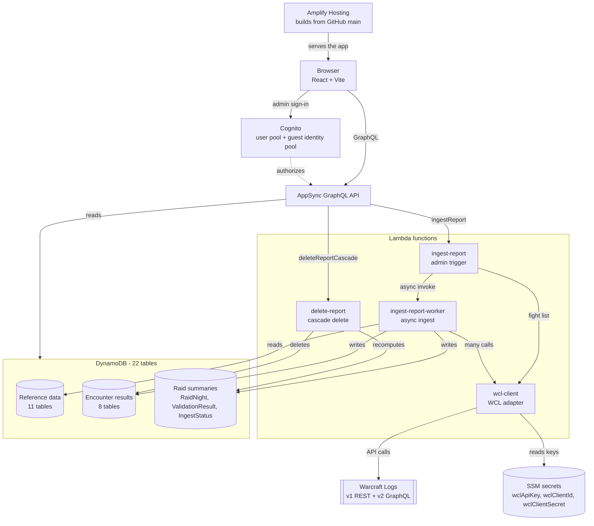
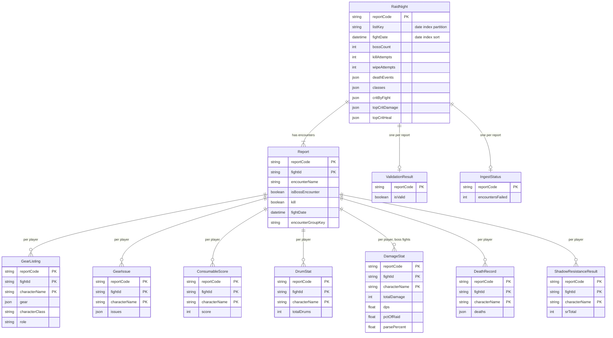
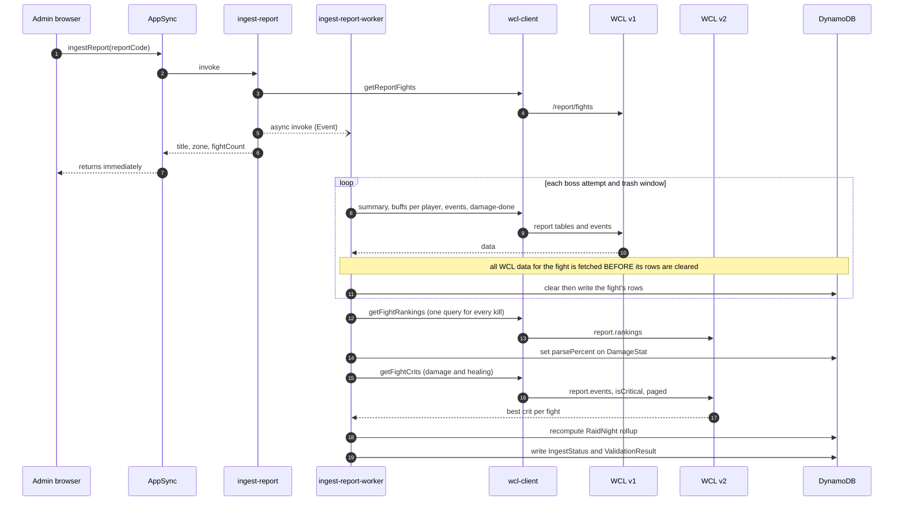
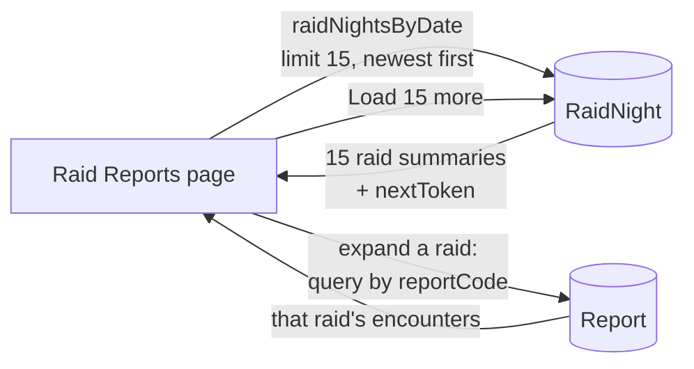
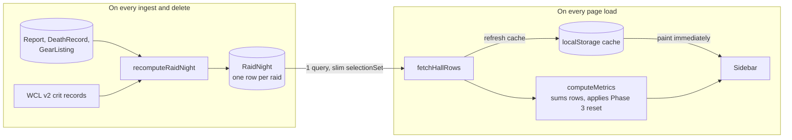

# Architecture

How **The L Word** fits together: a React frontend on AWS Amplify Hosting, an Amplify Gen 2 backend
(Cognito, AppSync, DynamoDB, Lambda), fed by the Warcraft Logs (WCL) API. The diagrams are
[Mermaid](https://mermaid.js.org/) — GitHub renders them, and they live in the repo so they version
with the code.

See also: [`API.md`](API.md) (every call), [`OPERATIONS.md`](OPERATIONS.md) (deploy and backfill),
and the [README](../README.md) (status and implementation notes).

## 1. System overview

**Auth.** Anyone can read (the identity pool's guest role); only the `admins` Cognito group can write
or call the two custom mutations. The browser reads through AppSync; the Lambdas write straight to
DynamoDB over IAM (see the README's "Writing directly to DynamoDB").

**Why the trigger/worker split.** AppSync resolvers are capped at 30 seconds, and a full raid night
needs well over a thousand WCL calls. `ingest-report` only fetches the fight list and fires
`ingest-report-worker` asynchronously (`InvocationType: Event`); encounters then appear in the list as
the worker finishes each one.

**Why `wcl-client` is its own Lambda.** It is the only code that knows WCL's request and response
shapes, so a change to WCL's API is a change to one file. It also owns the three secrets.

## 2. Table relationships

All 22 tables are listed in the README. The 11 reference tables (`ItemSocket`, `ShadowResistanceItem`,
`ShadowResistanceEnchant`, `CharacterRace`, `SuboptimalEnchant`, `ExcludedGearItem`, `GemQuality`,
`EnchantName`, `ItemName`, `RaidValidationRule`, `ConsumableBuff`) are looked up by item, enchant,
gem or zone id, so they have no foreign keys. The tables that *do* relate:

`reportCode` is the Warcraft Logs report id. `fightId` is one row per *encounter*: a real WCL fight id
for a boss attempt, or `trash-<firstId>-<lastId>` for a merged trash gap. The three-field tables are
stored with hash key `reportCode` and range key `fightId#characterName`.

`RaidNight` is a **derived** summary, rebuilt from the other tables after every ingest and delete. It is
what the Raid Reports list pages through and what the Hall of Records sums (sections 4 and 5).

## 3. Ingesting a raid

Failure handling: a failed fight is logged and skipped (and counted in `IngestStatus`); the parse and
crit steps are best-effort and never fail an ingest. See the README's "Worker modes" for the cheaper
re-run modes (`parsesOnly`, `raidNightOnly`, `critsOnly`).

## 4. Raid Reports list

Collapsed headers render from `RaidNight` alone; encounters are fetched only when a raid is expanded.
Zone and search are server-side filters, so they span every page.

## 5. Hall of Records

Each `RaidNight` row carries that raid's own contribution to every record, so the sidebar sums ~44 small
rows instead of scanning ~19,000 items. Before this design the Hall took about 17 seconds and 72 requests
to appear; it is now one request, and repeat visits paint from the cache first. Crit records come from WCL
and are carried forward across recomputes (`critByFight`), because they cannot be rebuilt from DynamoDB.
Details and definitions are in the README's "Hall of Records" section.
